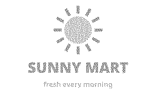
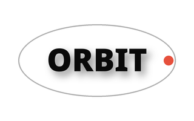
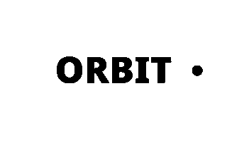
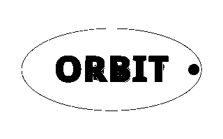
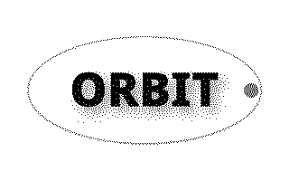
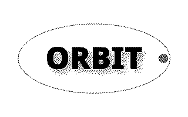

# flutter_android_usb_bulk_transfer

A Flutter plugin for Android USB bulk transfer. It allows communicating with USB devices using bulk endpoints.

## Features

- List connected USB devices.
- Connect to a USB device by Vendor ID and Product ID.
- Write raw bytes to a USB device.
- Read bytes from a USB device.
- Check connection status and disconnect.
- **Platform Safety**: Does nothing on non-Android platforms instead of failing.

## Usage

### List USB Devices

```dart
final plugin = FlutterAndroidUsbBulkTransfer();
List<Map<String, dynamic>> devices = await plugin.listUsbDevices();
for (var device in devices) {
  print('Device: ${device['deviceName']}, VID: ${device['vendorId']}, PID: ${device['productId']}');
}
```

### Connect to a USB Device

```dart
// Connect using specific VID and PID. If USB permission isn't granted yet, Android shows a permission dialog
// and this completes after the user answers it.
final connected = await plugin.connect(vid: 1234, pid: 5678);
if (!connected) {
  // Device not found, permission denied, or the device could not be opened.
}
```

### Write Data

```dart
final data = Uint8List.fromList([0x01, 0x02, 0x03, 0x04]);
await plugin.write(data);
```

### Read Data

```dart
final response = await plugin.read(64); // Read 64 bytes
if (response != null) {
  print('Received: $response');
}
```

### Check Connection and Disconnect

```dart
bool connected = await plugin.isConnected();
if (connected) {
  await plugin.disconnect();
}
```

## Bonus: POS/ESC Printer Support

This plugin includes specialized functionality for POS/ESC printers.

### Print PDF Page

Renders a PDF page into a bitmap and converts it to ESC/POS image commands.

```dart
await plugin.writePdf('/path/to/your/document.pdf');
```

Two optional parameters control how colours and greys are converted to black and white dots:

| Parameter | Default | Effect |
|---|---|---|
| `threshold` | `0.7` | Luminance (0-1) below which a dot prints black. Raise it to print darker. |
| `dithering` | `Dithering.none` | How greys and colours are simulated with dot patterns. |

| `dithering` | Result | Use for |
|---|---|---|
| `Dithering.none` | Solid black and white, decided by `threshold` alone. | Logos, QR codes, barcodes, text. |
| `Dithering.floydSteinberg()` | Smooth, fine-grained greys that keep even very light tints. Dark colours get white specks. | Photos, soft gradients. |
| `Dithering.atkinson()` | Higher-contrast greys; dark colours stay solid and light tints print as sparser dots. | Logos with gradients or shadows. |

Both dithering algorithms take an optional `strength` (0-1, default 1). It is the fraction of each dot's rounding
error that is spread to its neighbours: lower values keep more of the image solid.

```dart
// Logos, QR codes and text (default): solid output.
await plugin.writePdf(path);

// Logo with gradients or shadows.
await plugin.writePdf(path, dithering: const Dithering.atkinson());

// Photo.
await plugin.writePdf(path, dithering: const Dithering.floydSteinberg());

// In between: shaded mid-tones, mostly solid.
await plugin.writePdf(path, dithering: const Dithering.atkinson(strength: 0.5));
```

### How logos print

Each logo below was converted by the plugin's own encoder and decoded back into printer dots. The logos are
fictional brands drawn for this README.

| Original | `threshold: 0.5` | Default | `Dithering.floydSteinberg()` | `Dithering.atkinson()` |
|---|---|---|---|---|
|  |  |  |  |  |
|  |  |  |  |  |
|  |  |  |  |  |
|  |  |  |  |  |
|  |  |  |  |  |

- **Solid dark colours (KESTREL)** print the same at every threshold and with Atkinson. Floyd–Steinberg adds white
  specks, because it reproduces navy as slightly lighter than black.
- **Gradients (SUMMIT)**: at 0.5 the lighter tops of the mountains are cut off. The default prints the shape whole.
  Both dithering algorithms shade the mountains and keep the light-orange sun; Atkinson keeps the navy wordmark
  solid, Floyd–Steinberg speckles it.
- **Light colours (SUNNY MART)**: at 0.5 nothing prints. The default keeps orange but drops yellow and pale text.
  Use dithering, or raise `threshold` to about 0.85, for logos built from light colours.
- **White text on a colour (FRESH)**: the default prints a solid badge with crisp white text. At 0.5 the green badge
  disappears. Both dithering algorithms turn the green into a dot texture that makes small white text harder to
  read.
- **Thin light lines and soft shadows (ORBIT)**: a line whose brightness is close to the threshold prints as a
  dashed line, like the light-grey ring at the default 0.7. Lower `threshold` to about 0.5 to drop the ring and the
  shadow cleanly. Raising it to 0.85 prints the ring solid but turns the soft shadow into a black smear behind the
  text.

Keep `Dithering.none` for pages with QR codes or barcodes so their modules stay solid.

## Android Setup

Ensure your `AndroidManifest.xml` includes the USB host feature. The plugin handles runtime permission requests.

```xml
<uses-feature android:name="android.hardware.usb.host" />
```

## License

Apache 2.0
